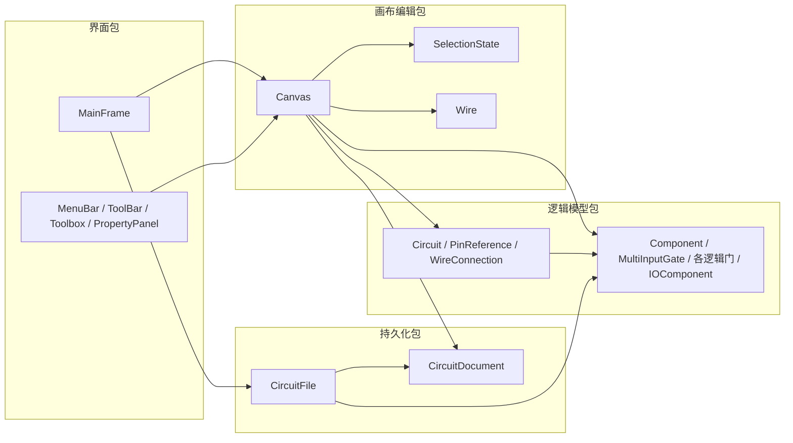
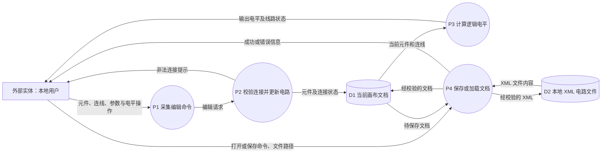
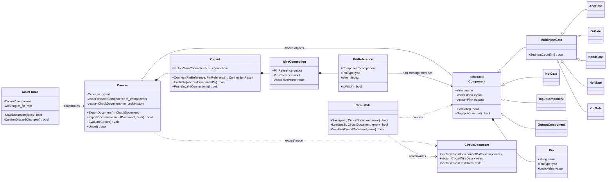

# 数字电路编辑与逻辑仿真系统设计图代码

以下图以当前仓库的类和模块为依据，可在 Mermaid 编辑器中渲染。包图和类图表达面向对象设计；数据流图从面向过程的角度说明输入、处理及文件数据的流向。数据流图不表示 UML 类之间的调用顺序。

## 1 包图

包按职责划分，是对现有源文件的逻辑归类，不代表 C++ 命名空间或独立部署单元。界面经 `Canvas` 修改模型；`CircuitFile` 经 `CircuitDocument` 完成持久化，加载时创建具体元件。

## 2 数据流图

`D1` 是运行时的画布状态，`D2` 是持久化文件。保存方向为 `D1 → P4 → D2`，加载方向为 `D2 → P4 → D1`；加载失败时不替换 `D1`。`P2` 对重复连接、同向引脚、输入占用和反馈环路执行校验。`P3` 按拓扑顺序传播二值电平。

## 3 类图

`PinReference` 只引用元件，不拥有元件；元件删除或引脚数量变化时，`Circuit` 必须清理无效连接。`CircuitDocument` 用 ID 表示文件中的元件关系，不保存内存指针。
