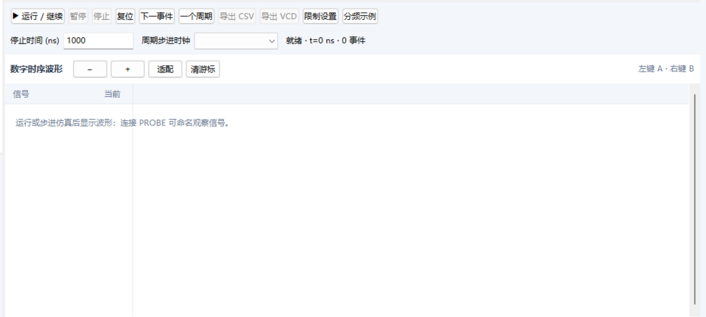
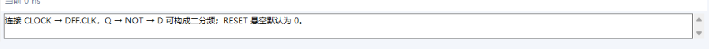
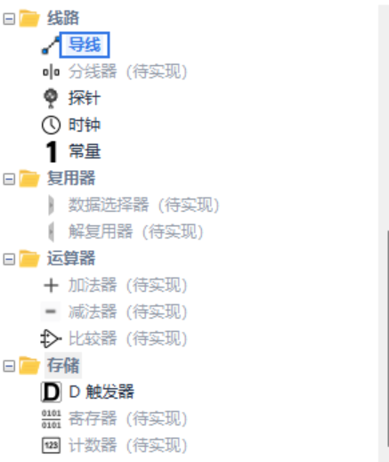
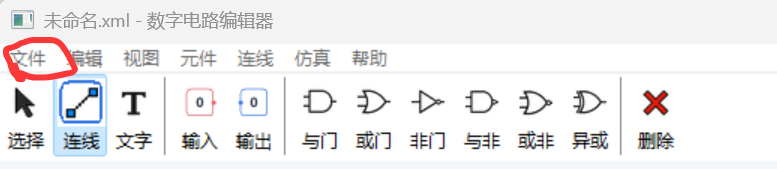

这个部分要单独开一个新的窗口，不占用原本的网格位置，打开按钮放在最上面“文件”“编辑”那一行或者下面都行

---

这个直接删掉，AI感太强

---

这个部分我完成的不是很好，这些元器件都没有做完，最好可以查一下这些的作用，然后能挑一两个完成一下，然后能做出像刚刚展示那样的上下沿的触发（我自己试了感觉效果不是很好，我也没咋看懂数电）（这个地方啃起来可能会有点难，辛苦辛苦）

---

pcb导入导出：

文件里面现在有pcb的导入，但是没有导出，所以最好可以做一个导出，让最后导出文件可以有两种选择，一个是xml文件，一个是pcb文件。

---

（可选任务）（如果时间充裕并且额度允许的情况下：）

他们小组展示的时候那个生成逻辑代码那个功能挺好的，我们可以抄袭一下（（（（

然后是根据我问了gpt的内容更新，这个可以等我下周继续做也行

